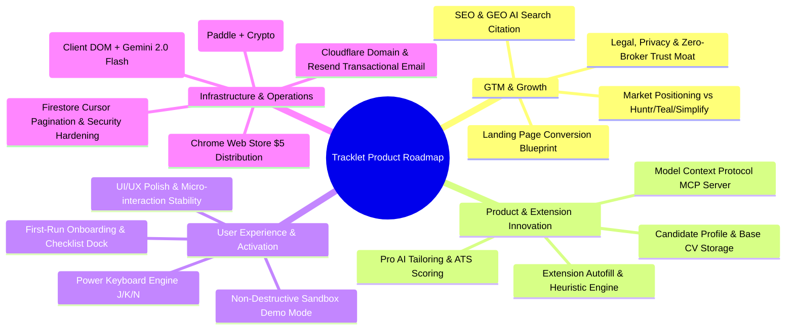

# Tracklet — Master Product & Technical Execution Roadmap

> **Branch**: `startup`  
> **Status**: Approved Strategy & Execution Plan  
> **Core Wedge**: *"The fast, privacy-respecting career workspace without $40/month fees or selling candidate data."*

---

## Strategic Pillar Overview



---

## 1. Market Positioning & Competitive Wedge (Priority)

### 1.1 The Asymmetric Positioning
The job-search tooling market is bifurcated into predatory incumbents and exploitative data brokers:
* **Huntr ($40/month)**: Stagnant 2016-era Kanban UX, pricing predatory toward unemployed candidates.
* **Teal ($29/month or $9/week)**: Opaque weekly billing traps, excessive cognitive load, heavy generic resume spam.
* **Simplify (Free)**: Acts as a **candidate data broker**—subsidizes free autofill by monetizing candidate profiles and application activity directly to corporate recruiters ($5k–$25k/yr contracts).
* **Tsenta / LazyApply ($19–$99/month)**: Headless browser auto-apply bots that trigger ATS spam filters, knockout disqualifications, and recruiter blacklists.
* **Notion & Spreadsheets (70% status quo)**: Completely manual, zero duplicate checking, no ATS autofill, no recruiter email tracking.

### 1.2 Tracklet’s Core Value Proposition
> **"The fast, privacy-respecting career command center that doesn’t sell your data or charge $40/month."**  
> *Anti-bot, relationship-first job tracking. Capture roles in 1-click, autofill ATS applications safely, manage recruiter communications, and prep for interviews in one unified workspace.*

### 1.3 Pricing Model: The "Job Hunt Pass"
Job searches last 2–4 months. Open-ended monthly subscriptions during unemployment create resentment.
* **Free Tier ($0)**: Up to 20 active applications, ATS Chrome Extension capture, standard autofill from base profile, CSV export anytime. No credit card required.
* **Pro Tier ($12/month)**: Unlimited active roles, advanced pipeline velocity analytics, email correspondence logging.
* **The Hero Offer: "Job Hunt Pass" ($29 one-time for 3 months)**: Full Pro access for a realistic search cycle. Low friction, no subscription dread.

---

## 2. Landing Page Conversion Blueprint

Review of `feat/landing-page` (`landing.html`) and integration strategy:
1. **Hero Section Refinement**:
   - Primary Headline: *"The command center for your job search."*
   - Sub-headline: *"Autofill ATS forms. Clip jobs in one click. Track every stage, contact, and email without paying $40/mo or selling your candidate data."*
   - Dual CTAs: `[ Start Free — No Credit Card ]` + `[ Add to Chrome (Free) ]`.
2. **The 3 Trust Badges (Immediate Counter-Punch)**:
   - 🛡️ **Zero Data Brokering**: You are the customer, not the product. We never sell your resume to recruiters.
   - ⚡ **1-Click Autofill**: Works natively across Greenhouse, Lever, Ashby, and Workday.
   - 🤝 **Targeted, Anti-Bot Results**: 15 networked, well-prepped applications beat 500 bot submissions every time.
3. **Interactive Visual Proof**:
   - Embed a 15-second lightweight WebM/MP4 micro-demo showing the Chrome side-panel opening on a Greenhouse page, detecting duplicates, and autofilling in 1 click.
4. **Competitor Comparison Table**:
   - Direct side-by-side matrix (Tracklet vs Huntr vs Teal vs Simplify vs Spreadsheets) highlighting price, extension, privacy/data selling, and networking CRM.

---

## 3. SEO & Generative Engine Optimization (GEO / AI Search) (Priority)

When users ask ChatGPT, Perplexity, Claude, or Google Gemini:
*"What are the best Huntr or Teal alternatives in 2026?"* or *"What job tracker extension doesn't sell my data?"*, Tracklet must be cited.

### 3.1 GEO Implementation: `llms.txt` and Schema.org
* **Deploy `/public/llms.txt`**: Standardized, clean Markdown specification detailing Tracklet’s pricing ($0 / $29 Pass), privacy covenants, ATS platform support, and differentiation against Teal and Simplify.
* **Deep JSON-LD Schemas**:
  - `SoftwareApplication` with application category `BusinessApplication`.
  - `FAQPage` schema on `landing.html` and compare pages addressing: *"How does Tracklet compare to Huntr?"*, *"Does Tracklet sell candidate data like Simplify?"*, *"How does the Job Hunt Pass work?"*.

### 3.2 Programmatic SEO (pSEO) Hubs
* `/compare/huntr-alternative`
* `/compare/teal-alternative`
* `/compare/simplify-alternative`
* `/ats/greenhouse-application-tracker`
* `/ats/workday-application-tracker`
* `/ats/lever-application-tracker`

---

## 4. Extension Auto Fill & Base/Tailored CV Architecture

### 4.1 Data Architecture
* **Candidate Profile Schema**: Stored as a singleton document at `/users/{userId}/profile/candidate` containing:
  - Personal contact info, portfolio/LinkedIn links, work authorization/sponsorship status, and demographic EEO fields.
  - Structured work experience arrays (title, company, dates, bullet points, tech stack).
  - Education arrays, categorized skills list, and raw PDF resume assets in Firebase Storage.
* **Storage Safe Caching**: Cached in the extension via `chrome.storage.local` (bypassing the strict 8KB `chrome.storage.sync` item limit).

### 4.2 4-Tier Field Detection & React Setter Bypass
1. **Tier 1 (Explicit ATS Selectors)**: Workday `[data-automation-id="..."]`, Greenhouse `input#first_name`, Lever `input[name="urls[LinkedIn]"]`.
2. **Tier 2 (Autocomplete & HTML5)**: `autocomplete="given-name"`, `autocomplete="email"`.
3. **Tier 3 (Label & ARIA)**: `label[for="..."]`, `aria-label`, placeholder heuristics.
4. **Tier 4 (Fuzzy Context Scoring)**: Surrounding container regex for ambiguous fields.
* **React Setter Bypass**: Modern ATS portals (Workday, Ashby) use React synthetic state trackers. Setting `input.value` directly fails. Tracklet uses native prototype property descriptors (`Object.getOwnPropertyDescriptor(HTMLInputElement.prototype, 'value').set`) followed by sequential `focus`, `input`, `change`, and `blur` events.

### 4.3 Pro AI Tailoring Engine (`user.planTier === 'pro'`)
* **ATS Keyword Match Score (0–100%)**: Compares the scraped JD against the candidate's base CV skills and experiences, outputting matching and missing keyword tags.
* **Dynamic Tailoring**: Free tier autofills standard base profile data. Pro tier dynamically tailors resume bullet points to emphasize relevant achievements and suggests tailored answers for custom questions (*"Why do you want to work at [Company]?"*).
* **Entitlement Gating**: Enforced via Firebase Auth custom claims (`token.planTier === 'pro'`) and gated serverless Cloud Functions.

---

## 5. Model Context Protocol (MCP) Server Feature

### 5.1 Architecture: `@tracklet/mcp-server`
Publish a lightweight, zero-dependency Node.js CLI package to npm: `npx @tracklet/mcp-server` using `@modelcontextprotocol/sdk` and `zod`.
Connects AI agents in **Claude Desktop, Cursor, VS Code, and Windsurf** directly to the candidate's Tracklet pipeline.

### 5.2 Non-Custodial Security Model
* Instead of unsafe Google Cloud IAM service account keys, the user clicks **"Generate MCP Token"** inside Tracklet Settings (`McpSettingsCard.tsx`).
* The token encapsulates the user's personal Firebase refresh token.
* On startup, `@tracklet/mcp-server` exchanges this for a scoped 1-hour `idToken` and calls Firestore REST API.
* **100% of Firestore security rules (`isOwner(userId)`) remain enforced.**

### 5.3 MCP Capabilities
* **Resources**:
  - `tracklet://applications/active`: Live summary of active applications.
  - `tracklet://profile/cv`: Structured candidate background and base CV markdown.
  - `tracklet://applications/{id}`: Full dossier (JD, recruiter notes, status history).
* **Tools**:
  - `list_applications`: Query by status, stale days, company.
  - `get_application`: Deep dossier inspection.
  - `add_application`: 1-click headless application logging.
  - `update_application_stage`: Move stage with debrief notes.
  - `log_interview_note`: Save post-interview impressions and questions.
* **Guided Prompts**:
  - `tailor_resume`: Tailor CV for a specific application in Tracklet.
  - `interview_prep`: Generate company-specific technical & behavioral interview prep.
  - `pipeline_audit`: Morning standup audit of stale applications and follow-up tasks.

---

## 6. Onboarding Flow & UI/UX Polish Roadmap

### 6.1 First-Run Activation
* **Contextual Workspace Stepper**: Avoid blocking modal wizards. Display a clean embedded hero banner when `applications.length === 0`.
* **Floating Smart Checklist Dock (`<OnboardingChecklistWidget />`)**:
  - 1. Install Companion Extension (Auto-detected via postMessage handshake).
  - 2. Import past applications (CSV / Notion).
  - 3. Add first active role (Shortcut `N`).
  - 4. Log a recruiter contact.
* **Isolated Sandbox Demo Mode**:
  - Tag sample applications with `isDemo: true`.
  - Fix current bug where loading sample data wipes real user applications.
  - Provide a 1-click **"Clear Demo Data"** button that only deletes `isDemo: true` records.

### 6.2 UI/UX Polish Phasing
* **Phase 1 (Micro-Interaction Stability)**: Remove `active:scale-[0.98]` and `transition-all` from button tokens to eliminate button bounce and reflow jitter. Replace with `transition-colors duration-150`.
* **Phase 2 (Kanban & Power Shortcuts)**: Add ghost drop indicators during card drag, bottom drop shelf for rapid Archive/Reject, and centralized keyboard navigation (`N` for new, `J`/`K` for sequential navigation, `/` for search, `Esc` for modals).
* **Phase 3 (Mobile Hardening)**: Convert detail drawer into native bottom sheet on screens < 640px with touch drag handle; ensure 44px minimum tap targets.
* **Phase 4 (WCAG AA & Dark Mode)**: Eliminate `text-slate-400` on light backgrounds; implement CSS theme variables for dark mode.

---

## 7. Legal, Privacy & Trust System

### 7.1 The "Zero Recruiter Monetization" Covenant
* Formalize the legal distinction against Simplify: Tracklet **never** sells, rents, or licenses candidate data to employers, recruiters, or data brokers.
* Full GDPR/CCPA data export (CSV/JSON) and permanent 1-click account erasure ("Danger Zone") in settings.
* Merge verified `add_legal_trust_pages` worktree (`/privacy` and `/terms`) with public unauthenticated route bypass in `App.tsx`.

---

## 8. Billing & Payments Strategy (Gaza Founder Constraints)

### 8.1 The Ground Reality & Fintech Pitfalls
* ⚠️ **Do NOT attempt remote US LLC incorporation (Doola, Firstbase) with Mercury Bank or Relay Financial in Phase 1.** Mercury and Relay explicitly prohibit accounts where the beneficial owner resides in Palestine, resulting in rejected applications or frozen capital.
* ⚠️ **Wise Business and Lemon Squeezy (Stripe-owned) do NOT onboard Palestinian residents.**
* ⚠️ **Estonian e-Residency requires picking up a physical cryptographic chip in person at an Estonian embassy** (none exist in Palestine; nearest in Cairo/Amman), making it non-viable while in Gaza.

### 8.2 Recommended Phase 1 Architecture (Zero Upfront Cost)
1. **Primary Fiat Processor: Paddle (Merchant of Record)**:
   - Paddle supports **Individual / Sole Trader** accounts (no foreign corporate entity required).
   - **Palestine is NOT on Paddle's sanctions/prohibited list.**
   - Configure payout rail: **Paddle $\rightarrow$ Payoneer (USD) $\rightarrow$ Bank of Palestine (BoP)**.
   - Payoneer Commercial Mastercard handles online software expenses (Vercel, domains, APIs).
2. **Secondary Checkout Rail: Crypto (USDC / USDT)**:
   - Target product: One-time **"Job Hunt Pass" ($29–$34)**.
   - Currencies: **USDC (Solana / Base)** or **USDT (Tron TRC-20)** via Helio or NOWPayments.
   - Provides an unblockable, sovereign checkout alternative with immediate local OTC/P2P cash liquidity in Gaza.

---

## 9. Infrastructure, Scraping, Email & Security Hardening

### 9.1 Reliable Cheap Scraping Pipeline
* **Tier 1 (Client-Side Extension DOM)**: Runs locally in the user's authentic browser session at **$0.00 cost** and **100% immunity** against Cloudflare Turnstile and LinkedIn login walls.
* **Tier 2 (Server-Side Fallback for Pasted URLs)**: Jina Reader API (`r.jina.ai/<url>`) at 10M free tokens/month.
* **LLM Engine**: Upgrade `api/scrape-job.ts` from invalid model identifiers (`gemini-3.5-flash-lite`) to **Google Gemini 2.0 Flash** ($0.10/1M input tokens, 1,500 free requests/day, native `responseSchema` JSON enforcement).

### 9.2 Low-Cost Brand Infrastructure
* **Domain**: Register on **Cloudflare Registrar** at wholesale cost ($10–$14/yr for `.app` or `.com`) with free WHOIS privacy, Anycast DNS, and Full (Strict) SSL.
* **Chrome Web Store $5**: Pay one-time $5 fee, submit justification for `<all_urls>` permission ("Required to clip job postings from arbitrary employer career sites upon user request"), bundle via `npm run package:ext`.
* **Transactional Emails**: Replace default Firebase template emails (`noreply@firebaseapp.com`) with **Resend** (3,000 free emails/month) + React Email. Dispatch branded verification magic links via Firebase Admin SDK.

### 9.3 Firestore Pagination Architecture
* Transition `loadApplications` from fetching entire subcollections to **cursor-based pagination**:
  - `ActivePipelineBoard`: Query bounded to active stages (`where('status', 'in', ACTIVE_STAGES)`), limit 100.
  - `AllApplicationsTable`: Paginated cursor query using `orderBy('createdAt', 'desc')` and `startAfter(lastDocSnapshot)` with 50 items per page and optimistic local prepending.

### 9.4 Security Audit Remediation
1. **SEC-01 (High)**: Patch `firestore.rules` to prevent registered users from reading all tester feedback and diagnostic stack traces in `/tester_feedback/`.
2. **SEC-02 (High)**: Enforce Firebase Auth ID token verification (`admin.auth().verifyIdToken(idToken)`) on `/api/scrape-job.ts`.
3. **SEC-03 (High)**: Eliminate `https://*.vercel.app/*` wildcard from `extension/manifest.json` `externally_connectable` to prevent extension hijacking.
4. **SEC-04 (Medium)**: Restrict CORS origins on `/api/report-issue.ts` to `tracklet.app`.

---

## 10. Master Execution Sprints

```
Sprint 1: Security, Domain, Email & Legal Foundation (Week 1)
  ├── Register domain on Cloudflare Registrar ($10-14/yr)
  ├── Apply SEC-01 & SEC-03 patches (firestore.rules & manifest.json)
  ├── Fix scrape-job.ts model identifier to gemini-2.0-flash
  ├── Integrate Resend free tier for branded auth emails
  └── Merge add_legal_trust_pages worktree (/privacy & /terms)

Sprint 2: Extension Autofill & Candidate Profile Hub (Week 2–3)
  ├── Implement candidate profile schema in src/types.ts & profileRepository.ts
  ├── Build Profile Settings View in web app
  ├── Implement 4-tier heuristic autofill engine in extension/content.js
  ├── Implement React prototype setter bypass
  └── Build Shadow DOM floating autofill pill

Sprint 3: Onboarding, Demo Mode & UI/UX Polish (Week 3–4)
  ├── Remove button bounce & transition-all from UI tokens
  ├── Build <OnboardingChecklistWidget /> with extension detection
  ├── Refactor seedDemoData to use isDemo: true and add safe clearDemoData
  ├── Implement global keyboard shortcuts (N, J, K, /, Esc)
  └── Implement Kanban ghost drop slot & reject/archive drop tray

Sprint 4: MCP Server & AI Pro Tailoring (Week 5–6)
  ├── Scaffold @tracklet/mcp-server with stdio transport & Zod schemas
  ├── Build McpSettingsCard with 1-click Claude Desktop/Cursor config export
  ├── Implement ATS Keyword Match Score & Cloud Function for tailored CV bullets
  └── Setup Pro entitlement gate (user.planTier === 'pro')

Sprint 5: Monetization & Chrome Web Store Distribution (Week 7)
  ├── Submit CWS developer account ($5) & package extension
  ├── Apply for Paddle Individual Sole Trader account linked to Payoneer BoP
  ├── Integrate Helio/NOWPayments for USDC/USDT Search Pass checkout
  └── Launch landing.html with comparison matrix & llms.txt
```
