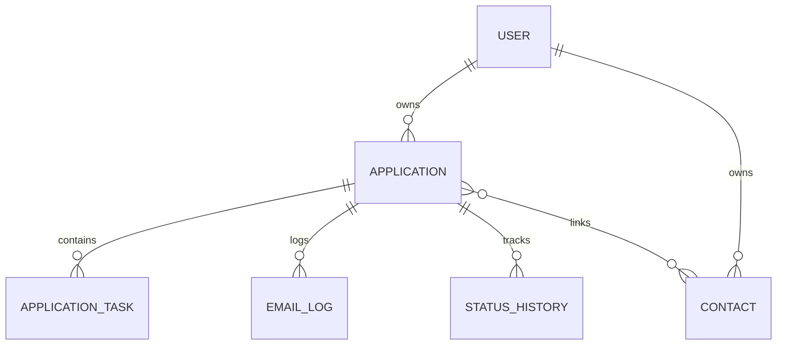
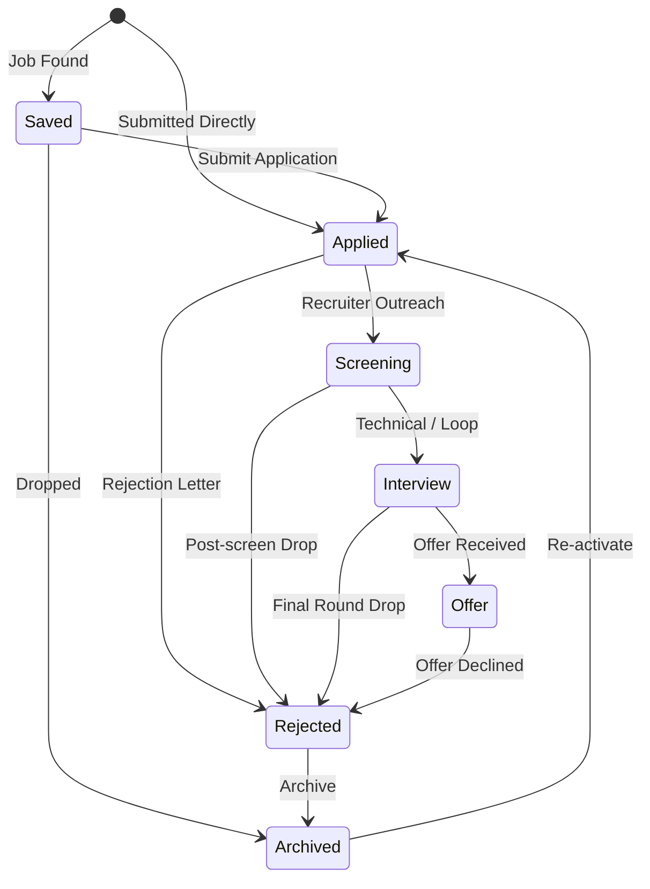

# Tracklet: Product Specification, Journey Maps & Testing Dossier

> **Prepared for**: Autonomous QA, Vibe-Testing (`vibe-test.tech`), and Technical Evaluation  
> **Target System**: Tracklet — Modern, High-Clarity Career Command Center & Application Tracker  
> **Tech Stack**: React 19, TypeScript, Vite, TailwindCSS v4, Firebase (Auth + Firestore), Chrome Extension MV3  
> **Compliance & Standard**: WCAG 2.1 AA, Offline-First / Guest-Friendly, Zero-Vendor-Lockin

---

## 1. Executive Summary & Product Brief

### 1.1 Product Purpose & Mental Model
**Tracklet** is an open-source, privacy-first career pipeline and job application manager. It replaces messy, passive spreadsheets with an active **Executive Command Center** built specifically for tech professionals (developers, designers, product managers) navigating high-velocity job searches (15–200+ active submissions).

Unlike closed-source SaaS trackers (Huntr, Teal) that monetize user career data behind paywalls, Tracklet offers:
1. **Immediate Zero-Barrier Guest Mode**: Instant usage out-of-the-box using local browser storage (`localStorage`) without requiring login or sign-up.
2. **Cloud Multi-Device Sync**: Optional sign-in via Google OAuth or Email/Password backed by Firebase Firestore.
3. **High Information Density**: Dense, tabular scanability (38px rows) and 5-stage Kanban boards that present pipeline health without visual fluff.
4. **Context Preservation**: Side-over drawers and LIFO-stacked modals prevent users from losing their workspace location when inspecting details, logs, or contacts.
5. **Full Data Ownership**: 1-click CSV import and export with built-in protection against formula injection attacks.

---

## 2. Core Entities & Data Architecture

### 2.1 Application Entity
Represents an individual job application record.
- `id` (string): Unique identifier.
- `company` (string, required): Company name.
- `role` (string, required): Job title / role applied for.
- `platform` (JobPlatform): Source platform (`LinkedIn` | `Indeed` | `Bayt` | `Lever` | `Greenhouse` | `Otta` | `Company Site` | `Referral` | `Wellfound` | `Other`).
- `status` (ApplicationStatus): Current pipeline stage (`Saved` | `Applied` | `Screening` | `Interview` | `Offer` | `Rejected` | `Archived`).
- `workLocation` (WorkLocation): `Remote` | `Hybrid` | `Onsite`.
- `employmentType` (EmploymentType): `Full-time` | `Part-time` | `Contract` | `Internship`.
- `dateApplied` (string): ISO date (`YYYY-MM-DD`).
- `jobLink` (string, optional): External URL to the original job posting.
- `notes` (string, optional): Markdown-formatted candidate notes.
- `contactIds` (string[]): Foreign keys linking to related `Contact` records.
- `tasks` (`ApplicationTask[]`): Embedded preparation tasks/to-dos.
- `emails` (`EmailLog[]`): Embedded correspondence records.
- `history` (`StatusHistoryEntry[]`): Chronological log of stage transitions with dwell durations.

### 2.2 Contact Entity
Represents a networking contact, recruiter, mentor, or hiring manager in the dedicated Contacts Hub.
- `id` (string): Unique identifier.
- `name` (string, required): Contact's full name.
- `category` (ContactCategory): `Mentor` | `Recruiter` | `Hiring Manager` | `Referral` | `Peer / Alumni` | `Other`.
- `organization` (string, optional): Company or firm name.
- `role` (string, optional): Professional title.
- `email` (string, optional): Email address.
- `phone` (string, optional): Phone number.
- `linkedIn` (string, optional): LinkedIn profile URL.
- `nextFollowUpDate` (string, optional): `YYYY-MM-DD` check-in reminder date.
- `applicationIds` (string[]): Foreign keys linking to related `Application` records.

### 2.3 Sub-Entities
- **ApplicationTask**: `{ id, title, completed: boolean, dueDate?: YYYY-MM-DD }`
- **EmailLog**: `{ id, subject, sender, recipient, date, timestamp, direction: 'inbound' | 'outbound', snippet, body, emailUrl }`
- **StatusHistoryEntry**: `{ id, status: ApplicationStatus, timestamp: ISO8601, note?: string }`

---

## 3. Application Lifecycle & Stage State Machine

Tracklet categorizes pipeline stages into **Active** and **Terminal** states:

| Stage | UI Tag / Badge Token | Meaning |
| :--- | :--- | :--- |
| **Saved** | `purple-600` / `bg-purple-50` | Role discovered, saved for review before submitting. |
| **Applied** | `slate-700` / `bg-slate-100` | Application submitted; waiting for initial recruiter response. |
| **Screening** | `amber-600` / `bg-amber-50` | Recruiter initial call, HR screening, or preliminary chat. |
| **Interview** | `blue-600` / `bg-blue-50` | Technical round, hiring manager interview, loop, or take-home test. |
| **Offer** | `emerald-600` / `bg-emerald-50` | Formal offer received; decision or negotiation phase. |
| **Rejected** | `rose-600` / `bg-rose-50` | Rejection email or candidate passed over (Terminal). |
| **Archived** | `slate-500` / `bg-slate-50` | Stale or withdrawn application kept for historical reference (Terminal). |

---

## 4. End-to-End User Journey Maps

```mermaid
flowchart TD
    subgraph J1["Journey 1: First-Run & Onboarding"]
        A1[Visit App] --> A2{User Choice}
        A2 -->|Guest Mode| A3[Instant Local Workspace]
        A2 -->|Sign Up / Login| A4[Cloud Firebase Workspace]
        A3 --> A5[1-Click Seed Demo Data]
    end

    subgraph J2["Journey 2: Application Capture"]
        B1[Press N or Add Button] --> B2[Add Application Modal]
        B2 --> B3[Fill Company, Role, Platform, Stage]
        B3 --> B4[Save Record]
        B4 --> B5[Optimistic Update + Toast]
    end

    subgraph J3["Journey 3: Pipeline Management"]
        C1[View Active Pipeline Board] --> C2[Drag & Drop Card Between Stages]
        C2 --> C3[Stage Updated + Dwell Counter Reset]
        C1 --> C4[Table View: Search & Multi-Select Bulk Actions]
    end

    subgraph J4["Journey 4: Deep Work & Interaction"]
        D1[Click Application Row/Card] --> D2[Open Right Slide-Over Drawer]
        D2 --> D3[Edit Markdown Notes with Slash Commands]
        D2 --> D4[Check off / Add Tasks]
        D2 --> D5[Link Contacts & View Email Logs]
    end

    subgraph J5["Journey 5: Contacts Hub & Networking"]
        E1[Navigate to Contacts View] --> E2[Filter by Due Follow-Ups]
        E2 --> E3[Open Contact Detail]
        E3 --> E4[1-Click Cross-Navigate to Linked Job]
    end

    subgraph J6["Journey 6: Analytics & Settings"]
        F1[Open Stats View] --> F2[Inspect Conversion Funnel & Stale Roles]
        F1 --> F3[Settings: CSV Import / Export / Expiry Config]
    end
```

### Detailed Journey Steps & Expected UX

#### Journey 1: First-Run & Onboarding
1. **Entry**: User lands on `/login` or auth gate.
2. **Action**: Clicks **"Continue as Guest"**.
3. **Result**: App immediately redirects to the dashboard (`/applications` or `/pipeline`) in offline-first guest mode. No loading spinners or sign-up gates.
4. **Empty State Experience**: If zero applications exist, empty state shows a primary CTA button: **"Seed Demo Data"**.
5. **Seeding Action**: Clicking "Seed Demo Data" populates 6–10 realistic applications across all 5 active stages, complete with markdown interview notes, tasks, and contacts.

#### Journey 2: Rapid Job Entry
1. **Trigger**: User presses hotkey `N` anywhere in the app (or clicks **"+ Add Application"** in the top bar).
2. **Action**: `AddApplicationModal` opens with keyboard focus on the `Company` input.
3. **Form Fields**:
   - Company name & Job title (Required).
   - Platform select dropdown (default: `LinkedIn`).
   - Work location (`Remote`, `Hybrid`, `Onsite`).
   - Employment type (`Full-time`, `Contract`, etc.).
   - Initial status stage (default: `Applied`).
   - Direct job link.
4. **Submission**: Submitting adds the application immediately to the top of the list/board (Optimistic UI) and shows a snackbar receipt: *"Application Added"*.

#### Journey 3: Pipeline Kanban Management (`/pipeline`)
1. **Visual Structure**: 5 stage columns (`Saved`, `Applied`, `Screening`, `Interview`, `Offer`).
2. **Card Urgency Signals**: Each card displays days spent in the current stage (e.g. `3d`, `14d`). If an application exceeds the configured stale threshold (default 14 days), an urgency indicator appears.
3. **Drag & Drop**: User drags a card from `Applied` to `Screening`.
4. **Result**:
   - Card drops into the new column with zero lag.
   - Status history logs the transition.
   - A snackbar appears at the bottom with an **"Undo"** button.
   - Clicking "Undo" immediately moves the card back to `Applied`.

#### Journey 4: Tabular View & Bulk Management (`/all`)
1. **Layout**: High-density 38px table rows displaying Company, Role, Platform, Stage Badge, Date Applied, and Actions.
2. **Search**: Pressing `Ctrl+K` focuses the global search bar. Typing instantly filters by company, role, or notes.
3. **Multi-Select Bulk Actions**: Checking multiple rows surfaces the floating bulk action bar:
   - Bulk update status to any stage.
   - Bulk delete selected with undoable confirmation.
   - Bulk export selected to CSV.

#### Journey 5: Application Detail Slide-Over Drawer
1. **Trigger**: Clicking any table row or kanban card opens `ApplicationDetailPanel` from the right side of the screen.
2. **Context Preservation**: The main workspace remains visible behind the drawer.
3. **Sub-Features**:
   - **Stage Dropdown**: Change stage immediately from within the drawer.
   - **Rich Markdown Notes**: Built-in editor supporting bold, italic, bullet lists, headers, and slash commands (`/`). Shows live auto-save indicators (`Saved` / `Saving…`).
   - **Actionable Tasks**: Checklist to add interview prep items, take-home tests, and set due dates.
   - **Linked Contacts**: Surfaces recruiters and hiring managers tied to this role with 1-click email/LinkedIn actions.
   - **Chronological Spine**: Status history shows every date the application moved stages and how many days it stayed in each.

#### Journey 6: Contacts & Networking Hub (`/contacts`)
1. **Layout**: Dedicated directory of career contacts segmented by category (`Recruiter`, `Hiring Manager`, `Mentor`, `Referral`, `Peer`).
2. **Follow-Up Intelligence**:
   - A top filter chip `[🔔 Due Follow-ups (N)]` isolates contacts whose scheduled check-in date is today or overdue.
   - Sidebar badge displays the count of pending follow-ups.
3. **Bidirectional Deep Linking**:
   - Clicking a contact opens `ContactDetailPanel`.
   - Contact panel lists all linked applications.
   - Clicking an application opens `ApplicationDetailPanel` in a layered LIFO stack without losing contact context. Pressing `Escape` returns to the contact.

#### Journey 7: Analytics Dashboard (`/stats`)
1. **KPI Cards**: Total Applications, Active Pipeline count, Response Rate (%), Offer Rate (%).
2. **Visual Funnel**: Visual distribution showing candidate drop-off across `Applied ➔ Screening ➔ Interview ➔ Offer`.
3. **Platform Distribution**: Bar/donut charts breaking down application volume across LinkedIn, Indeed, Referrals, etc.
4. **Stale Applications Audit**: Dedicated audit table highlighting all active roles that have not received an update in >14 days.

#### Journey 8: Settings & Data Freedom (`/settings`)
1. **Stale Expiry Threshold**: Slider/input to configure staleness sensitivity (e.g. 7, 14, 21, 30 days).
2. **CSV Export**: 1-click download of all application records formatted cleanly with formula injection neutralization.
3. **CSV Batch Import**: Modal allowing file drop, column mapping verification, and preview before bulk insertion.
4. **Account & Guest Migration**:
   - When a guest user decides to sign in with Google or Email/Password, `GuestMigrationModal` prompts to safely merge local guest records into the cloud database.

#### Journey 9: Tester Issue & Feedback Reporter
1. **Trigger**: Global hotkey `Ctrl+Shift+B` (or `Ctrl+Alt+B`) or sidebar feedback button.
2. **Action**: `TesterReportModal` opens.
3. **Diagnostics**: Automatically attaches current URL, active tab, user status (Guest vs Auth), and viewport dimensions. Allows entering issue title, description, category, and severity.

---

## 5. UI/UX Rules, Invariants & Design Standards

To ensure automated vibe-tests and crawlers recognize expected vs broken behaviors:

### 5.1 Universal Behavioral Invariants
1. **Zero Browser Alerts**: Tracklet never invokes `window.alert()`, `window.confirm()`, or `window.prompt()`. All prompts are custom in-app accessible modals or snackbars with `Undo`.
2. **Universal Outbound Links**: All `mailto:`, `tel:`, and external job/LinkedIn URLs MUST have `target="_blank" rel="noopener noreferrer"`. The user's active session is never navigated away.
3. **Optimistic UI with Rollback**: Card updates, drag-and-drop moves, and note edits update UI immediately. If remote Firestore write fails, state rolls back automatically and an error toast is surfaced.
4. **Escape Key Hierarchy (LIFO)**: Pressing `Escape` dismisses the topmost modal or drawer. If both a modal and drawer are open, `Escape` closes the modal first, preserving the drawer.
5. **Keyboard Shortcuts**:
   - `N`: Open Add Application Modal (when not focused on a text input).
   - `Ctrl+K` or `/`: Focus global search filter.
   - `Escape`: Close active drawer, modal, or dropdown.
   - `Ctrl+Shift+B` or `Ctrl+Alt+B`: Open Tester Feedback Reporter.

### 5.2 Color Tokens & Urgency Hierarchy
- Primary Brand: Blue `#2563eb` (`bg-blue-600`)
- Screening Accent: Amber `#d97706` (`text-amber-700 bg-amber-50`)
- Interview Accent: Blue `#2563eb` (`text-blue-700 bg-blue-50`)
- Offer Accent: Emerald `#059669` (`text-emerald-700 bg-emerald-50`)
- Rejection Accent: Rose `#e11d48` (`text-rose-700 bg-rose-50`)
- Destructive Actions (Delete, Discard): Subtle resting slate, rose hover: `text-slate-500 hover:text-rose-600 hover:bg-rose-50`. No alarming permanent red buttons.

---

## 6. Comprehensive Vibe-Test Assertion Matrix

This matrix provides explicit scenarios for automated evaluation by `vibe-test.tech`:

| Test ID | Test Scenario | Pre-condition | Action / Input | Expected Result | Fail Condition |
| :--- | :--- | :--- | :--- | :--- | :--- |
| **TC-01** | **Guest Mode Entry** | Logged out on `/login` | Click "Continue as Guest" | Lands on `/pipeline` or `/all`, guest toast appears, local storage initialized | Prompts for login again, blank white screen |
| **TC-02** | **Demo Data Seeding** | Empty workspace (0 jobs) | Click "Seed Demo Data" | 6–10 job cards appear across Kanban columns; Stats reflect active jobs | No jobs rendered, error toast |
| **TC-03** | **Rapid Job Creation (`N`)** | Workspace loaded | Press `N` key | `AddApplicationModal` opens with autofocus on Company field | Modal does not open or text input not focused |
| **TC-04** | **Form Validation** | Add Modal open | Click "Save Application" with blank fields | Inline validation prevents submit; highlights Company & Role | Empty card created or page reloads |
| **TC-05** | **Optimistic Card Add** | Add Modal open | Fill Company: "Acme Corp", Role: "Staff Engineer", Status: "Applied", Save | Modal closes immediately, Acme Corp appears in `Applied` column, toast receipt displayed | Modal hangs waiting for network, card not visible |
| **TC-06** | **Kanban Drag & Drop** | Card exists in `Applied` | Drag card to `Screening` | Card moves to `Screening` column; snackbar displays "Moved to Screening" with "Undo" | Card snaps back, error thrown |
| **TC-07** | **Undo Stage Transition** | Just moved card | Click "Undo" on snackbar | Card moves back to `Applied` immediately | Card remains in `Screening` or disappears |
| **TC-08** | **Detail Drawer LIFO** | On Kanban or Table | Click any job card | `ApplicationDetailPanel` slides in from right; URL/state preserves view | Page refreshes or view resets |
| **TC-09** | **Notes Markdown & Autosave** | Detail panel open | Type `# Interview Questions` into notes editor | Heading renders formatted; auto-save badge flips `Saving…` ➔ `Saved` | Text lost on drawer close, raw unrendered markdown |
| **TC-10** | **Task Checklist Toggle** | Detail panel open | Add task "Review System Design", click checkbox | Checkbox checks with strike-through styling; task state persists | Checkbox fails to toggle or throws error |
| **TC-11** | **Contacts Bidirectional Link** | Detail panel open | Select "Link Contact", pick existing or create new | Contact appears in linked section; navigating to Contacts tab shows linked application | Contact not linked, or link broken in Contacts hub |
| **TC-12** | **Due Follow-Up Filter** | In Contacts view | Click `[🔔 Due Follow-ups]` filter chip | Table filters strictly to contacts with overdue or today check-in dates | Shows all contacts or empty table unexpectedly |
| **TC-13** | **CSV Export Integrity** | >=1 application exists | Click "Export CSV" | Browser triggers download of `.csv` file; cells starting with `=`/`+`/`-` are quoted/escaped | Download fails or spreadsheet formula executes |
| **TC-14** | **CSV Import Flow** | In Settings view | Upload valid CSV with mapped headers | Preview modal lists records; clicking "Import" populates applications table | Unhandled parse crash, corrupted dates |
| **TC-15** | **Modal Dismissal (`Esc`)** | Add Modal or Drawer open | Press `Escape` key | Modal/drawer closes cleanly; returns focus to workspace | Overlay remains stuck on screen |
| **TC-16** | **Search Filtering (`Ctrl+K`)** | 10+ jobs in table | Press `Ctrl+K`, type existing company name | Table instantly filters to matching records in real time (<50ms) | No match found, laggy UI freeze |
| **TC-17** | **Duplicate Warning Banner** | 1 Acme Engineer exists | Add another Acme Engineer | Yellow duplicate notification banner appears at top of workspace | No duplicate detection surfaced |
| **TC-18** | **Feedback Hotkey** | Anywhere in app | Press `Ctrl+Shift+B` | `TesterReportModal` opens with pre-populated diagnostics | Hotkey does nothing |

---

## 7. Edge Cases & Safety Guardrails

1. **Guest Storage Quota**: Guest mode uses browser `localStorage`. If storage is restricted (private browsing quota limit), Tracklet gracefully traps storage errors and presents a non-intrusive warning to sign in for unbounded Firestore cloud storage.
2. **Stale Application Calculation**: Dwell time is calculated from the latest entry in `history[]`. If `history[]` is empty, fallback calculates dwell time from `dateApplied`.
3. **Sanitization Against Formula Injection (CWE-1236)**: When exporting CSV, any text field beginning with `=`, `+`, `-`, or `@` is prepended with `'` to prevent malicious spreadsheet formula execution.
4. **Email Verification Gate**: If an authenticated cloud user has not verified their email, they are directed to the `/verify-email` gate with a 60-second cooldown on verification resends. Guest users are exempt.
5. **No Blind Deletion**: Deleting an application or contact always provides either a modal confirmation or an instant Undo snackbar. Unlinking a contact from an application never deletes the contact entity itself.
