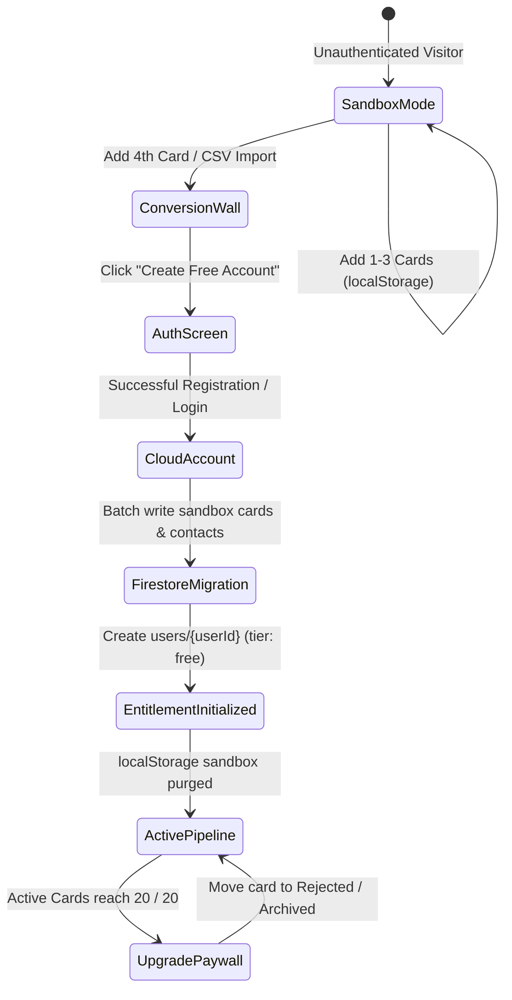

# Phase 1 Data Model & Interface Contracts: SaaS Auth Unification, Guest Mode Sunset & API Hardening

**Branch**: `013-saas-auth-guest-sunset`  
**Date**: 2026-10-22  
**Status**: Completed  
**Spec Reference**: [spec.md](./spec.md)

---

## 1. Domain Types & Schemas (`src/types.ts`)

```typescript
// --- Plan Tiers & Subscriptions ---
export type PlanTier = 'free' | 'pro';

export type SubscriptionStatus = 
  | 'none' 
  | 'active' 
  | 'past_due' 
  | 'canceled' 
  | 'trialing';

export interface UserQuotas {
  scrapesUsedThisMonth: number;
  autofillsUsedThisMonth: number;
  quotaResetAt: string; // ISO 8601 string, e.g. "2026-11-01T00:00:00.000Z"
}

export interface UserEntitlementProfile {
  uid: string;
  email: string | null;
  displayName: string | null;
  planTier: PlanTier;
  subscriptionStatus: SubscriptionStatus;
  currentPeriodEnd?: string | null;
  stripeCustomerId?: string | null;
  quotas: UserQuotas;
  createdAt: string;
  updatedAt: string;
}

// --- Paywall & Upgrade Triggers ---
export type PaywallTriggerContext = 
  | 'pipeline_cap' 
  | 'scrape_limit' 
  | 'autofill_limit' 
  | 'feature_gate';

export interface PaywallModalProps {
  isOpen: boolean;
  onClose: () => void;
  triggerContext: PaywallTriggerContext;
  currentUsage?: number;
  maxQuota?: number;
  onUpgradeClick?: () => void;
}

// --- Chrome Extension User Session ---
export interface ExtensionUserSession {
  uid: string;
  email: string | null;
  idToken: string;
  refreshToken: string;
  planTier: PlanTier;
  activeApplicationsCount?: number;
  expiresAt: number; // Unix epoch milliseconds
  syncedAt: number;  // Unix epoch milliseconds
}
```

---

## 2. Canonical Constants & Quotas (`src/lib/constants.ts`)

```typescript
// SaaS Tier Limits (Guest Mode and Sandbox Sunset)
export const SAAS_LIMITS = {
  FREE_MAX_ACTIVE_APPS: 20,
  FREE_MONTHLY_SCRAPES: 20,
  PRO_MONTHLY_SCRAPES: 500,
} as const;

export const DEFAULT_USER_QUOTAS: UserQuotas = {
  scrapesUsedThisMonth: 0,
  autofillsUsedThisMonth: 0,
  quotaResetAt: new Date(new Date().getFullYear(), new Date().getMonth() + 1, 1).toISOString(),
};
```

---

## 3. Serverless API Contracts

### A. `POST /api/scrape-job`

#### Headers
```http
Authorization: Bearer <firebaseIdToken>
Content-Type: application/json
```

#### Request Body
```json
{
  "pageText": "Job posting description prose up to 12000 chars...",
  "pageUrl": "https://company.greenhouse.io/job/123",
  "pageTitle": "Senior Frontend Engineer"
}
```

#### Responses
- **200 OK**:
  ```json
  {
    "role": "Senior Frontend Engineer",
    "company": "Acme Corp",
    "companyDomain": "acme.com",
    "location": "London, UK",
    "workLocation": "Hybrid",
    "employmentType": "Full-time",
    "salary": "£90,000 - £110,000",
    "notes": "Full markdown job description...",
    "scrapesRemaining": 14
  }
  ```
- **401 Unauthorized**:
  ```json
  {
    "error": "Unauthorized",
    "message": "Valid Firebase ID token required."
  }
  ```
- **429 Too Many Requests**:
  ```json
  {
    "error": "QUOTA_EXCEEDED",
    "message": "Monthly AI scraping limit reached (20/20). Upgrade to Pro for 500 monthly scrapes.",
    "upgradeUrl": "/settings?tab=subscription"
  }
  ```

---

### B. `POST /api/report-issue`

#### Headers
```http
Authorization: Bearer <firebaseIdToken>
Content-Type: application/json
```

#### Request Body
```json
{
  "type": "bug",
  "title": "Pipeline card drag dropped onto terminal column rejected unexpectedly",
  "description": "Steps to reproduce...",
  "severity": "medium",
  "diagnostics": {
    "appVersion": "1.0.0",
    "activeTab": "pipeline",
    "url": "https://tracklet.app",
    "browser": "Chrome 128",
    "os": "Windows",
    "viewport": "1920x1080",
    "devicePixelRatio": 1,
    "authMode": "authenticated",
    "userId": "usr_abc123",
    "timestamp": "2026-10-22T16:45:00.000Z",
    "recentErrors": []
  }
}
```

#### Responses
- **200 OK**:
  ```json
  {
    "success": true,
    "issueNumber": 42,
    "issueUrl": "https://github.com/saleem-15/Tracklet-React/issues/42"
  }
  ```
- **401 Unauthorized**:
  ```json
  {
    "error": "Unauthorized",
    "message": "Valid Firebase ID token required to submit issue reports."
  }
  ```

---

## 4. Entity State Lifecycle: Sandbox to Cloud Migration


