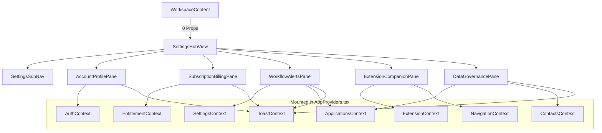

# Implementation Plan: Settings Hub Redesign (015-settings-hub-redesign)

**Branch**: `feat/settings-hub-redesign` | **Date**: 2026-10-28 | **Spec**: [spec.md](./spec.md)  
**Analysis Reference**: [SETTINGS_PAGE_ANALYSIS.md](file:///C:/Users/Saleem/.gemini/antigravity/brain/a0c35185-8ef1-4c9b-9f0c-0219634da059/SETTINGS_PAGE_ANALYSIS.md)

---

## Summary

Refactor Tracklet's monolithic 655-line `SettingsView.tsx` into a modular, production-grade **Settings Hub** conforming to the *"Executive Command Center"* design system (`DESIGN.md`). Replace the flat 7-card scroll with a responsive **Master-Detail Split-Pane Architecture** (5 categorized panes: Account & Profile, Subscription & Billing, Workflow & Alerts, Browser Extension, Data & Governance). Migrate user notification preferences from `localStorage` to Cloud Firestore (`users/{userId}/preferences`) per Constitution Principle I. Introduce the commercial **Job Hunt Pass ($29 / 3 months)** and full 4-dimensional SaaS quota meters. Eliminate all 12 drilled props from `WorkspaceContent.tsx` by consuming directly from existing context providers. Enforce the 10% Accent Rule, WCAG AA contrast standards, and Apple HIG-grade interaction controls.

---

## Technical Context

**Language/Version**: TypeScript 5.x / React 19 / Vite  
**Design Tokens**: `DESIGN.md` (Outfit display, Plus Jakarta Sans body, JetBrains Mono data tokens), `src/theme/tokens.ts` (`UI_TOKENS`)  
**State & Persistence**: Firebase Auth, Cloud Firestore (`users/{userId}/preferences`, `users/{userId}/profile`), `SettingsContext`, `EntitlementContext`  
**Icons**: Lucide React (`lucide-react`)  
**Testing**: Vitest (`tests/unit/`)  
**Target Surfaces**: Web App (`src/`) & Chrome Extension MV3 (`extension/`)  
**Quality Guardrails**: Zero component files $> 300$ lines, zero `text-slate-400` on light backgrounds, zero session-hijacking outbound links, zero unauthenticated serverless routes.

---

## Constitution Check

*GATE: Must pass before Phase 0 research. Re-check after Phase 1 design.*

- [x] **I. Cloud-First, User-Scoped Persistence**: Migrates `tracklet_expiry_settings_v1` from client-side `localStorage` to Cloud Firestore under `users/{userId}/preferences`. Candidate profile data saved to `users/{userId}/profile`.
- [x] **II. Entitlement & Tier-First Feature Design**: Visualizes Free vs Pro tiers, adds Job Hunt Pass ($29/3mo) packaging, meters 4 entitlement dimensions (apps, scrapes, autofills, resumes), and links to Stripe Customer Portal.
- [x] **III. Authenticated & Rate-Limited Serverless Endpoints**: All profile and preference mutations are governed by Firestore security rules requiring `request.auth.uid == userId`.
- [x] **IV. Extension & Web Parity**: Implements the web Candidate Job Hunt Target profile that syncs bi-directionally with the Chrome Extension's ATS autofill engine (`extension/profileStorage.js`).
- [x] **V. High-Craft UI/UX & Performance Standards**: Adheres to `DESIGN.md` tokens, Apple HIG master-detail layout, 10% accent rule, 44px touch targets, and WCAG AA contrast compliance.

---

## Project Structure & Component Architecture

### Documentation Artifacts (this feature)

```text
specs/015-settings-hub-redesign/
├── spec.md              # Feature specification
├── plan.md              # This implementation plan
├── research.md          # Benchmark analysis, heuristic audit & ergonomics
├── data-model.md        # Firestore schemas & TypeScript interfaces
├── quickstart.md        # Step-by-step verification procedures
└── tasks.md             # Dependency-ordered task breakdown
```

### Source Code Decomposition

```text
src/
├── types.ts                               # Add UserPreferences, CandidateProfile, SettingsPaneId
├── context/
│   ├── SettingsContext.tsx                 # Upgrade to sync with Firestore users/{userId}/preferences
│   └── EntitlementContext.tsx             # Support Job Hunt Pass & 4-dimension quotas
├── hooks/
│   ├── useExpirySettings.ts               # Refactor to read/write Firestore with local cache fallback
│   └── useCandidateProfile.ts             # New hook for candidate profile sync
├── components/
│   ├── layout/
│   │   └── WorkspaceContent.tsx           # Remove 12 drilled props; render <SettingsView /> directly
│   └── settings/                          # NEW: Modular settings subsystem
│       ├── SettingsHubView.tsx            # Master layout & responsive pane router (~110 lines)
│       ├── SettingsSubNav.tsx             # Desktop vertical rail & mobile pill bar (~95 lines)
│       ├── SettingsCard.tsx               # Canonical card container primitive (~40 lines)
│       ├── SettingsRow.tsx                # Apple HIG list row primitive (~50 lines)
│       ├── SettingsSwitch.tsx             # Accessible 44px toggle primitive (~35 lines)
│       ├── SettingsStepInput.tsx          # Precision stepped threshold control (~75 lines)
│       └── panes/
│           ├── AccountProfilePane.tsx     # Identity, candidate target, danger zone (~220 lines)
│           ├── SubscriptionBillingPane.tsx# Plan tiers, 4 quota meters, Stripe portal (~195 lines)
│           ├── WorkflowAlertsPane.tsx     # Expiry window, staleness policy (~180 lines)
│           ├── ExtensionCompanionPane.tsx # Extension pairing, diagnostics, package download (~150 lines)
│           └── DataGovernancePane.tsx     # JSON/CSV backup, trust covenants, demo reset (~215 lines)
```

---

## State & Context Integration Map



---

## Phased Implementation Roadmap

### Phase 1: Foundation & Shared Primitives
- Define TypeScript types in `src/types.ts` (`SettingsPaneId`, `UserPreferences`, `CandidateProfile`).
- Build canonical primitives in `src/components/settings/`:
  - `SettingsCard.tsx` (standardized border-slate-200, rounded-2xl, flat-by-default).
  - `SettingsRow.tsx` (title, helper text, trailing control).
  - `SettingsSwitch.tsx` (Command Blue active state, 44x44px touch target).
  - `SettingsStepInput.tsx` (stepped threshold adjuster with dual units).
- Build `SettingsSubNav.tsx` supporting desktop vertical rail and mobile segmented pill tabs.

### Phase 2: Cloud Firestore Persistence (Constitution Principle I)
- Refactor `src/hooks/useExpirySettings.ts` to read/write Firestore `users/{userId}/preferences`.
- Create `src/hooks/useCandidateProfile.ts` to manage profile sync with Firestore `users/{userId}/profile` and Chrome Extension.
- Update `firestore.rules` to enforce `users/{userId}/preferences` and `users/{userId}/profile` access.

### Phase 3: Modular Panes Implementation
- Implement `AccountProfilePane.tsx` (identity, candidate job target, password reset, GDPR delete modal).
- Implement `SubscriptionBillingPane.tsx` (Free vs Pro Monthly vs Job Hunt Pass, 4 quota meters, Stripe portal trigger).
- Implement `WorkflowAlertsPane.tsx` (expiry lookahead, staleness policy, presets, precision stepper).
- Implement `ExtensionCompanionPane.tsx` (version diagnostic, live cross-tab status, zip package download).
- Implement `DataGovernancePane.tsx` (JSON backup/restore, CSV exports, CSV import modal trigger, trust covenants).

### Phase 4: Integration & Prop-Drilling Elimination
- Implement `SettingsHubView.tsx` assembling the sub-navigation and active pane rendering.
- Update `src/components/layout/WorkspaceContent.tsx`: replace the 12-prop `<SettingsView>` call with `<SettingsHubView />`.
- Relocate sidebar task alert badge from *Settings* to *Pipeline* in `Sidebar.tsx`.

### Phase 5: Verification & Accessibility Hardening
- Audit and resolve all contrast violations (`text-slate-400` $\rightarrow$ `text-slate-500`).
- Verify keyboard accessibility (`Tab`, `Escape`, `Enter`).
- Run `tests/unit/` test suite and verify 0 TypeScript compilation errors.
