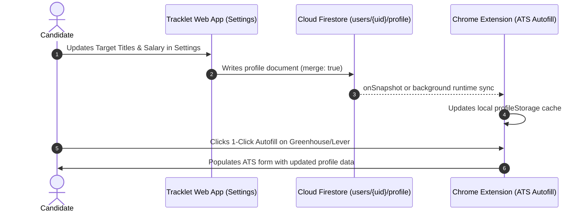

# Technical & UX Research: Settings Hub Redesign (015-settings-hub-redesign)

**Feature**: Settings Hub Redesign  
**Date**: 2026-10-28  
**References**: `DESIGN.md`, Apple Human Interface Guidelines, Nielsen Norman Group Usability Heuristics, Linear, Raycast, Stripe, macOS Settings

---

## 1. Competitive & Industry Benchmark Analysis

To transform Tracklet's Settings into an executive command center, we evaluated the settings architectures of premier software platforms:

### 1.1 Linear Workspace Settings
- **Layout**: Two-column layout with a left sidebar navigation rail and focused right-hand content pane.
- **Mental Model**: Decoupled into `Personal` (Profile, Preferences, Notifications) and `Workspace` (Members, Teams, Billing, Integrations).
- **Control Patterns**: Grouped list items bounded by hairline dividers. Toggle switches are standard brand blue. Actions are aligned to the right edge.
- **Key Takeaway for Tracklet**: Adopting the vertical rail navigation immediately cures the 3,200px vertical scroll fatigue. Users can jump directly to the setting they need in 1 click.

### 1.2 Raycast Preferences
- **Layout**: Segmented top header tabs (`General`, `Extensions`, `AI`, `Advanced`, `Account`).
- **Interaction**: Keyboard-first navigation (`Cmd+1..5`). Searchable preference filter. Instantaneous local-first feedback backed by encrypted cloud vault.
- **Key Takeaway for Tracklet**: Preserving fast tab switching without page reload, keeping font-weights constant, and supporting keyboard shortcuts.

### 1.3 Apple macOS System Settings (Human Interface Guidelines)
- **Hierarchy**: Split-pane layout. The leading pane presents categorized settings sections with recognizable system icons. The trailing pane presents clean grouped rows (`SettingsRow`).
- **Control Sizing**: Minimum 44x44pt touch bounding boxes for switches and buttons. Clear typographic hierarchy separating row titles (`Outfit 600, 14px`) from descriptive subtitles (`Plus Jakarta Sans 400, 12px`).
- **Color Discipline**: Accent colors are applied strictly to interactive controls (switches, primary buttons) or genuine alerts. Routine list items and cards remain neutral.
- **Key Takeaway for Tracklet**: Eliminating the "rainbow effect" of pastel gradients and amber switches. Command Blue is the primary interactive color; amber is reserved exclusively for urgent deadlines.

---

## 2. Usability Heuristics & Ergonomic Audit

### 2.1 Nielsen Norman 10 Usability Heuristics Evaluation

| Heuristic | Violation in Current Codebase | Remediation in Redesign |
| :--- | :--- | :--- |
| **#1: Visibility of System Status** | Changing the expiry threshold slider has no immediate receipt toast; progress bars in PlanUsage lack ARIA values. | Add immediate toast feedback receipts (`addToast`); add semantic `role="progressbar"` with `aria-valuenow`. |
| **#2: Match Between System and Real World** | Threshold stepper uses arbitrary `+-6h` increments and displays raw hours up to 168h/720h. Humans think in days beyond 48 hours. | Introduce segmented presets (`12h`, `24h (1d)`, `48h (2d)`, `72h (3d)`, `7d`) and dual-unit stepper (`Hours` / `Days`). |
| **#3: User Control and Freedom** | Deleting a follow-up template emits a toast with NO `Undo` action; clicking "Reload Demo Data" overwrites workspace immediately without confirmation. | Add `Undo` callback to deletion toast; guard demo data reset with an explicit modal confirmation dialog. |
| **#4: Consistency and Standards** | Nested `rounded-2xl` containers inside `rounded-2xl` cards create warped corners; toggle switch uses `bg-amber-500` instead of standard interactive blue. | Standardize outer cards to `rounded-2xl` (16px) and inner elements to `rounded-xl` (12px); switch uses `bg-blue-600`. |
| **#6: Recognition Rather Than Recall** | Card 6 (Templates) and Card 7 (Data Portability) are buried 3 viewport heights below the fold. | Categorized sub-navigation makes all domains visible at a glance. |
| **#8: Aesthetic and Minimalist Design** | Live interactive task cards are embedded inside the settings expiry configuration box, mixing operational work with preference configuration. | Relocate active task records to the Pipeline board; settings shows only a clean configuration preview. |

### 2.2 Fitts's Law & Touch Target Ergonomics
- **The Problem**: Current toggle button is exactly $24\times 44\text{px}$, falling short of the $44\times 44\text{px}$ minimum standard (WCAG 2.2 Success Criterion 2.5.8). On mobile devices, users frequently miss the switch and tap the surrounding container.
- **The Solution**: Wrap the switch in an invisible touch target padding box:
  ```tsx
  <label className="relative inline-flex items-center justify-center p-2.5 -m-2.5 cursor-pointer">
    <input type="checkbox" role="switch" ... className="sr-only peer" />
    <div className="w-11 h-6 bg-slate-200 peer-checked:bg-blue-600 rounded-full ...">...</div>
  </label>
  ```

---

## 3. Chromatic Restructuring (The 10% Accent Rule)

`DESIGN.md` dictates:
> *"Accent colors (`#2563eb`, `#059669`, `#d97706`) appear on $\le 10\%$ of any given view surface. Their rarity preserves instant scanability."*

### Current Palette vs. Redesigned Palette

```
CURRENT (Overcrowded, >45% accent coverage):
[ Amber Toggle ] [ Purple Pro Badge ] [ Emerald Verified ] [ Blue Extension CTA ]
[ Indigo Scrape Bar ] [ Amber Preset ] [ Rose Overdue Badge ] [ Pastel Gradient Tiles ]

REDESIGNED (Strict 10% Rule, Executive Command Center):
[ Neutral Card Surface (bg-white border-slate-200) ]
  ├── Interactive Controls: Command Blue (#2563eb) strictly
  ├── System Urgency: Amber (#d97706) strictly for <24h deadlines & unverified email
  ├── Confirmed Trust: Emerald (#059669) strictly for security covenants & verified status
  └── Destructive Actions: Calm Slate rest state, hovering into Rose (#e11d48)
```

---

## 4. Cloud Persistence vs. Local Storage Architecture

### 4.1 Constitution Principle I Compliance
- **Violation**: `src/hooks/useExpirySettings.ts` writes directly to `localStorage.setItem('tracklet_expiry_settings_v1', ...)`.
- **Architectural Remedy**:
  1. On initial mount, read from Firestore `users/{userId}/preferences`.
  2. If offline or loading, initialize from `localStorage.getItem('tracklet_prefs_' + userId)`.
  3. When the user updates settings, immediately update React state (optimistic UI), update the local cache, and write to Firestore in the background:
     ```typescript
     await setDoc(doc(db, 'users', userId, 'preferences', 'settings'), newSettings, { merge: true });
     ```
  4. Automatic rollback and error toast if the Firestore sync fails.

---

## 5. Candidate Profile & Chrome Extension Parity

### 5.1 Extension Data Model Audit (`extension/profileStorage.js`)
The Chrome Extension maintains an internal candidate profile:
```javascript
{
  fullName: '',
  firstName: '',
  lastName: '',
  email: '',
  phone: '',
  location: '',
  linkedInUrl: '',
  githubUrl: '',
  portfolioUrl: '',
  targetTitle: '',
  workAuthorization: '',
  preferredResumeName: ''
}
```
Currently, the extension provides no way to edit this profile outside of tiny input fields in the extension popup. The web app's new **Candidate Profile** section in `AccountProfilePane.tsx` will serve as the single source of truth, syncing bi-directionally via Firestore:


