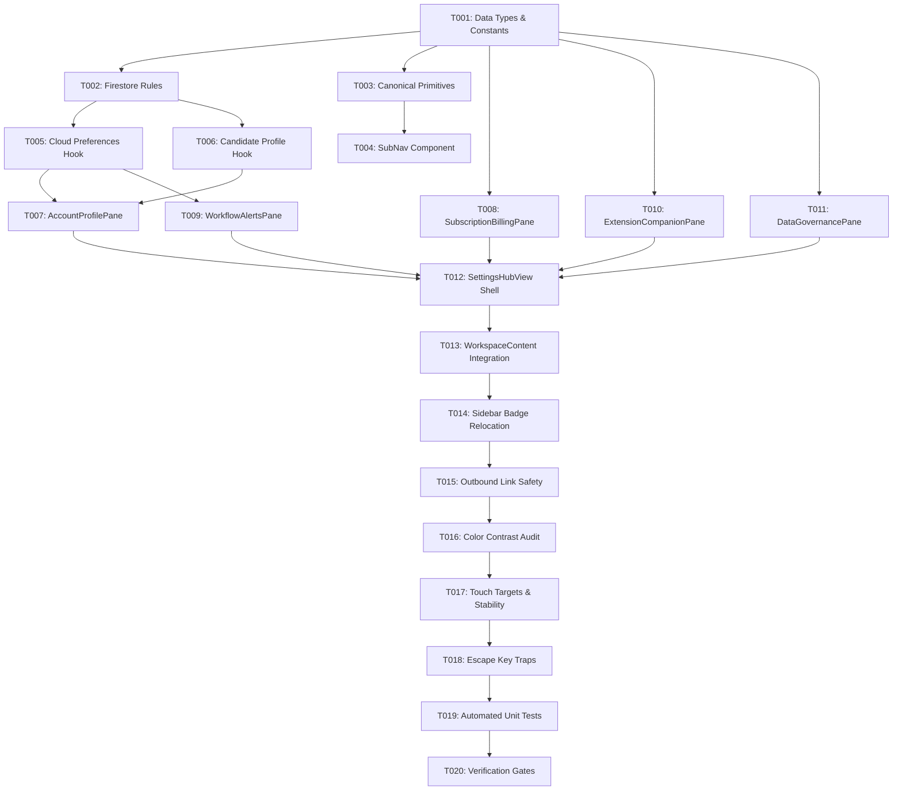

# Implementation Tasks: Settings Hub Redesign (015-settings-hub-redesign)

**Feature**: Settings Hub Redesign  
**Status**: Completed  
**Estimated Effort**: 5 Phases / 20 Tasks  
**Specification Reference**: [spec.md](./spec.md) | [plan.md](./plan.md)

---

## Task Dependency Overview

---

## Phase 1: Foundation, Types & Canonical Primitives

- [x] **T001**: Define Settings interfaces in `src/types.ts`
  - Add `SettingsPaneId`, `UserPreferences`, `CandidateProfile`, `CommercialPlanType`, `SalaryTarget`.
  - Add `SAAS_PRICING` constants to `src/lib/constants.ts` (Pro Monthly `$12`, Job Hunt Pass `$29`).
- [x] **T002**: Update `firestore.rules` for Preferences & Profile
  - Add rules allowing read/write on `/users/{userId}/preferences/{docId}` and `/users/{userId}/profile/{docId}` strictly when `request.auth.uid == userId`.
- [x] **T003**: Create canonical settings primitives in `src/components/settings/`
  - `src/components/settings/SettingsCard.tsx`: Standardized `rounded-2xl border-slate-200 bg-white p-5 sm:p-6 shadow-2xs`.
  - `src/components/settings/SettingsRow.tsx`: Standardized horizontal list item with icon, title, subtitle, and trailing control.
  - `src/components/settings/SettingsSwitch.tsx`: Accessible toggle with Command Blue (`bg-blue-600`) active color and $44\times 44\text{px}$ touch target.
  - `src/components/settings/SettingsStepInput.tsx`: Dual-unit stepped threshold adjuster (Hours / Days).
- [x] **T004**: Create `src/components/settings/SettingsSubNav.tsx`
  - Responsive sub-navigation rendering a left vertical rail (`w-56`) on `lg:` ($\ge 1024\text{px}$) and a horizontal segmented pill bar on `< 1024\text{px}`.

---

## Phase 2: Cloud Persistence & Domain Hooks (Constitution Principle I)

- [x] **T005**: Upgrade `src/hooks/useExpirySettings.ts` to Cloud Firestore
  - When authenticated (`user?.uid`), read and write preferences to Firestore `users/{userId}/preferences/settings`.
  - Maintain `localStorage` solely as an offline read-through cache scoped by `userId`.
  - Emit immediate toast feedback upon update.
- [x] **T006**: Create `src/hooks/useCandidateProfile.ts`
  - Encapsulate candidate profile data (`targetTitles`, `salaryTarget`, `targetLocations`, `workAuthorization`, `links`).
  - Read/write to Firestore `users/{userId}/profile/candidate` with optimistic local state.
  - Connect with Chrome Extension background sync.

---

## Phase 3: Modular Panes Implementation

- [x] **T007**: Build `src/components/settings/panes/AccountProfilePane.tsx`
  - User identity, avatar, Google OAuth / Password provider badge, verified email status with resend cooldown.
  - Candidate Job Hunt Target form (titles, salary, locations, work authorization, links).
  - Password reset action, sign out button.
  - Danger Zone: Delete account trigger in calm slate at rest (`border-slate-300 text-slate-700`) opening `DeleteAccountModal`.
- [x] **T008**: Build `src/components/settings/panes/SubscriptionBillingPane.tsx`
  - Current plan status badge.
  - 4 SaaS entitlement quota progress bars (Active Applications, AI Scrapes, ATS Autofills, Cloud Resumes) with `role="progressbar"`.
  - Pricing cards: Tracklet Pro Monthly ($12/mo) and Job Hunt Pass ($29/3mo — Best Value).
  - Self-service Stripe Customer Portal trigger for payment methods and tax invoices.
  - Job Hunt Sabbatical / Pause flow.
- [x] **T009**: Build `src/components/settings/panes/WorkflowAlertsPane.tsx`
  - Soon to Expire notification indicator toggle (`SettingsSwitch`).
  - Quick select presets (`12h`, `24h (1d)`, `48h (2d)`, `72h (3d)`, `7d`).
  - `SettingsStepInput` for custom threshold adjustments.
  - Application staleness warning toggle (14 / 21 / 30 days).
  - Compact due tasks indicator summary (pure configuration feedback; zero live draggable cards).
- [x] **T010**: Build `src/components/settings/panes/ExtensionCompanionPane.tsx`
  - Chrome extension live connection badge and installed version diagnostic.
  - 1-click package download link (`tracklet-extension-v<version>.zip`) with download anchor.
  - Setup guide and shortcut overlay launcher.
  - Default clip stage setting (`Saved` vs `Applied`).
  - Duplicate detection sensitivity toggle.
- [x] **T011**: Build `src/components/settings/panes/DataGovernancePane.tsx`
  - Full workspace snapshot: Download JSON backup and Restore from JSON file input.
  - Spreadsheet portability: Export Jobs (CSV), Export Contacts (CSV), Import CSV launcher.
  - Enterprise Security & Trust covenants (Zero Recruiter Monetization, AES-256 Cloud Sync, PII-Masked Telemetry).
  - Client diagnostics bar and Beta Issue Reporter trigger (`Ctrl+Alt+B`).
  - Demo data reload action guarded by a pre-action confirmation modal.

---

## Phase 4: Integration & Prop-Drilling Elimination

- [x] **T012**: Build `src/components/settings/SettingsHubView.tsx`
  - Assemble `SettingsSubNav` and active pane view router.
  - Manage active pane state with URL query parameter synchronization (`?tab=settings&section=<paneId>`).
  - Ensure total component line count $\le 120$ lines.
- [x] **T013**: Refactor `src/components/layout/WorkspaceContent.tsx`
  - Eliminate the 12 drilled props at line 254.
  - Replace `<SettingsView ... />` with `<SettingsHubView />` with zero props.
- [x] **T014**: Relocate Sidebar Task Alert Badge in `src/components/Sidebar.tsx`
  - Remove the task due warning indicator from the *Settings* navigation item.
  - Relocate urgent task badges to the *Pipeline* tab in accordance with Action-Only Navigation Badges (Rule 7).
- [x] **T015**: Ensure Outbound Link Safety Across Settings
  - In `SecurityPrivacyCard.tsx` and all legal links, ensure `target="_blank" rel="noopener noreferrer"` without session-hijacking `e.preventDefault()` handlers (Rule 1).

---

## Phase 5: Verification, Accessibility & Quality Gates

- [x] **T016**: Color Contrast Audit (WCAG AA 4.5:1)
  - Replace all `text-slate-400` on light backgrounds with `text-slate-500` or `text-slate-600`.
  - Verify all text in disabled states maintains $\ge 4.5:1$ contrast.
- [x] **T017**: Touch Target & Micro-Jitter Verification
  - Verify all switches, tabs, and buttons meet $44\times 44\text{px}$ touch targets.
  - Verify font weights remain constant across active and inactive states.
- [x] **T018**: Keyboard & Escape Key Traps
  - Verify `Escape` cleanly dismisses `DeleteAccountModal`, `ImportCSVModal`, and demo reset dialogs using `useEscapeKey`.
- [x] **T019**: Automated Unit Tests
  - Write unit test `tests/unit/settingsHubView.test.tsx` verifying pane switching, URL hash sync, and quota rendering.
  - Update unit test `tests/unit/useExpirySettings.test.tsx` verifying Firestore read/write and local cache fallback.
- [x] **T020**: TypeScript Typecheck & Build Gate
  - Run `npx tsc --noEmit` and confirm 0 errors.
  - Run `npm run build` and confirm successful production bundle.
