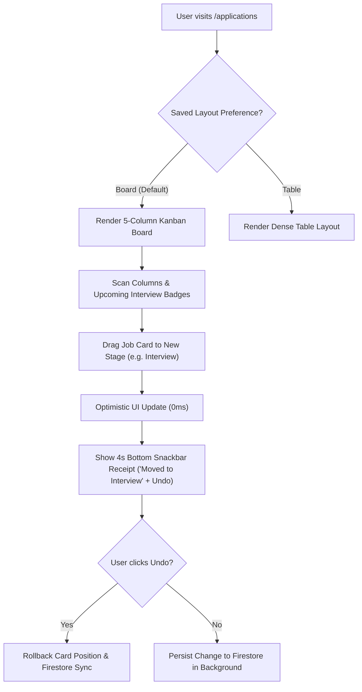
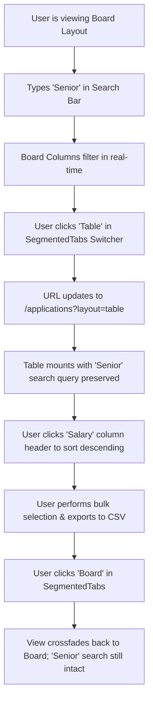
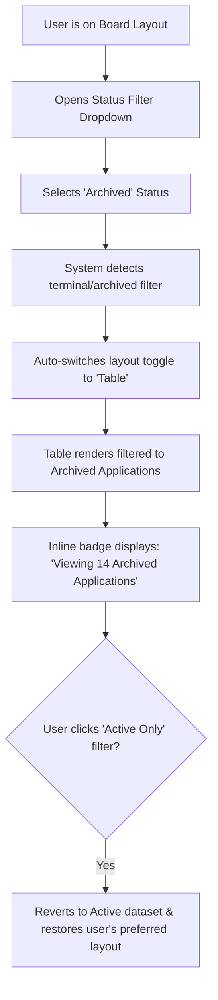

# UX Brief: Tracklet Unified Applications Hub

## Executive Summary
Tracklet is consolidating its two separated job tracking pages—"Active Pipeline" (Kanban board) and "All Applications" (Table)—into a unified, single-destination page at `/applications`. The chosen architecture is **Concept 1: The Dual-Lens Workspace**, which treats the job application collection as a single data entity while providing an instant, client-side layout switcher powered by Tracklet's canonical `SegmentedTabs` (`[ ⊞ Board ] [ ☰ Table ]`). This brief documents the complete UX discovery, user journeys, flows, information architecture, screen inventory, and decision criteria.

---

## 1. Problem & User Framing

* **Problem Statement:** Job seekers using Tracklet need a way to seamlessly view, triage, and audit their applications through both visual Kanban and dense tabular lenses on a single page, because separating applications across two disconnected pages fragments their mental model, resets active search and filter context, and creates unnecessary navigation friction.
* **Primary User:** Active job seekers (Free and Pro SaaS tiers) balancing high-velocity daily triage (interviews, follow-ups) with deep comparative auditing (salaries, dates, notes, bulk operations).

---

## 2. Solution Concepts Explored & Selection

### The 3 Concepts Evaluated

1. **Concept 1: The Dual-Lens Workspace (CHOSEN)**
   - *Model:* Single unified dataset with a persistent top toolbar featuring Tracklet's canonical `SegmentedTabs` (`[ ⊞ Board ] [ ☰ Table ]`).
   - *Mental Model:* *"I am looking at my job applications through different camera lenses."* The data is identical; only the layout changes.
   - *Why it Won:* 100% requirements coverage, instant (<150ms) context-preserving layout toggle, zero learning curve, optimal reuse of high-craft components (`ActivePipelineBoard` and `AllApplicationsTable`), and flawless responsiveness from mobile (snap-scroll) to widescreen desktop.

2. **Concept 2: Master-Detail Split Panel (REJECTED)**
   - *Model:* Left 35% list, right 65% stage timeline and detail canvas.
   - *Why it Lost:* Cramped horizontal space for Kanban columns on standard 13" laptop screens (1280px); high build complexity; incompatible with mobile screens without severe degradation.

3. **Concept 3: Triage vs. Audit Intent Modes (REJECTED)**
   - *Model:* Explicit mode banner splitting the application into "Triage Mode" (daily execution) and "Audit Mode" (weekly spreadsheet maintenance).
   - *Why it Lost:* Reintroduced the psychological fragmentation we aimed to eliminate by making users feel like they are working in two separate tools.

---

## 3. User Journey Map

| Stage | Goal | Actions | Thoughts & Feelings | Pain Points | Opportunities |
|---|---|---|---|---|---|
| **1. First Arrival (Day 1)** | Explore and get organized | Visits `/applications`, reviews 3-step setup checklist, clicks "Add Job" or "Seed Demo Data" | *"Hope this isn't complicated. I want to see my pipeline."* | Fear of empty spreadsheets | `OnboardingEmptyState` with 1-click demo seed and extension connection guide |
| **2. Active Pipeline Hunt** | Capture and triage new jobs daily | Clips jobs via extension; drags cards across `Saved` → `Applied` → `Interview` | *"Got an interview! Let me update this immediately."* | Losing track of interview dates | Visual column badges with day counts and immediate drag-and-drop feedback |
| **3. Comparative Audit** | Compare compensation and response dates | Searches "Remote", flips toggle to `Table`, sorts columns by salary | *"Which offer pays best? How many roles did I apply to?"* | Re-entering search queries after switching pages | Instant in-place layout crossfade preserving 100% of search query and filter state |
| **4. Historical Maintenance** | Review past rejections or archived roles | Selects `Status: Archived` in filter dropdown | *"Recruiter followed up on an old role. What were my notes?"* | Cluttering active board with old rejections | Smart auto-routing: selecting Archived shifts to Table layout with dense chronological rows |
| **5. Habitual Mastery** | Effortless multi-device pipeline management | Checks status on phone; executes bulk operations on desktop | *"Tracklet is my mission control. It just works."* | Broken mobile boards; accidental deletes | CSS horizontal column snap-scroll on mobile; 4s Undo snackbar receipts on all mutations |

---

## 4. User Flows for Core Jobs

### Flow 1: Daily Pipeline Triage (Board Layout)


### Flow 2: Search, Filter & Lens Switch (Board ⇄ Table)


### Flow 3: Smart Archive Routing


---

## 5. Information Architecture

```
[Global Header Navigation]
└── Brand: Tracklet (Logo + User Profile)
└── Navigation Links:
    ├── [Applications]  --> /applications (Single Unified Hub)
    ├── [Contacts]      --> /contacts (CRM)
    ├── [Analytics]     --> /analytics (Metrics)
    └── [Settings]       --> /settings (Account & Rules)

[Applications Page Canvas (/applications)]
├── 1. Sticky Command Toolbar (Global within Page)
│   ├── Search Input (Filter by Company, Title, Tags)
│   ├── Filter Pills: [Platform ▾] [Status: Active ▾] [Work ▾] [Job Type ▾] [Date ▾]
│   ├── Reset Filters Button (Conditional when filters active)
│   └── Right Actions Cluster:
│       ├── Layout Switcher: SegmentedTabs [ ⊞ Board | ☰ Table ]
│       └── Primary CTA: [+ Add Job] Button
│
└── 2. Dynamic View Container (Swapped by Layout Switcher)
    ├── LENS A: Board Layout (<ActivePipelineBoard />)
    │   ├── 5 Kanban Columns (Saved, Applied, Screening, Interview, Offer)
    │   ├── Column Stage Headers with dynamic counts
    │   └── Job Cards (Draggable, Interview Badges, Touch Target Menu)
    │
    └── LENS B: Table Layout (<AllApplicationsTable />)
        ├── Table Toolbar (Bulk Select Header, Batch Delete, Column Sorting)
        ├── Scrollable Table Matrix (Checkboxes, Company Logo, Stage Badge, Salary, Dates, Actions)
        └── Bulk Action Modal / Floating Action Bar
```

---

## 6. Screen Inventory & State Matrix

### Screen 1: Unified Applications Hub (Hero Screen)
* **Purpose:** Mission control for reviewing, triaging, and auditing all job applications.
* **Primary Action:** `+ Add Job` or drag card to advance stage.
* **Secondary Actions:** Layout toggle (`Board` ⇄ `Table`), Filter by Status/Platform, Column Sorting, Bulk Delete.
* **Content Priority:**
  1. Sticky Command Toolbar with Search, Status, and Layout Toggle.
  2. Active Applications (5 Stage Columns in Board / Dense Sortable Matrix in Table).
  3. Actionable metadata (Upcoming interview pills, days in stage, compensation tags).
* **States:**
  - *Day 1 (0 Total Apps):* `OnboardingEmptyState` with setup checklist + 4 action cards.
  - *Filtered Empty State (0 Results):* `EmptyState` with *"No applications match your filter"* and a 1-click *"Reset Filters"* button.
  - *Loading State:* Column skeleton placeholders (Board) or row skeletons (Table).
  - *Error State:* Inline banner with *"Sync failed. [Retry]"*.

### Screen 2: Application Detail Modal (Supporting Screen)
* **Purpose:** Deep inspection modal for notes, tasks, contacts, and email correspondence.
* **Implementation Note (Scope Agreement):** Preserved as centered modal (`ApplicationDetailPanel.tsx`) for v1. Future upgrade to Notion-style Side Peek Drawer is documented in `docs/future-tasks/notion-style-application-detail-peek.md`.
* **Primary Action:** Edit Details / Update Stage.
* **Dismissal:** ESC key (`useEscapeKey`), backdrop click, or Close button.

---

## 7. UX Principles for UI Execution

1. **Lens, Not Location:** Board and Table are two views of the same reality. Never force a user to re-navigate or re-enter filters when changing perspectives.
2. **Instant Feedback with Forgiveness:** All state mutations (moving cards, editing stages, archiving) execute optimistically in 0ms, backed by a persistent 4-second Undo snackbar.
3. **Calm by Default:** The default view is focused on active, in-flight work. Archived data stays accessible in one click without cluttering the daily triage canvas.
4. **Ergonomic Continuity:** Desktop leverages dense scanning and keyboard shortcuts; mobile leverages 44px touch targets and fluid horizontal column snapping.
5. **Voice & Tone:** Crisp, efficient, and encouraging. Never scolding or robotic. Status notices are clear receipts (e.g. *"Moved to Interview"*, *"Filter applied: Remote"*).
